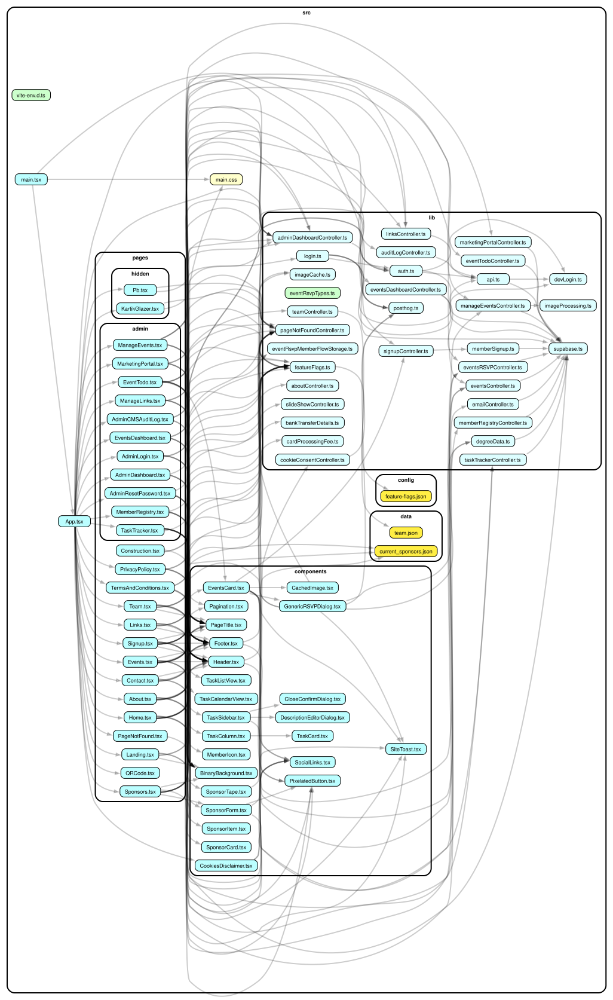

# DEVS Website

This repository contains the source code for the **DEVS (Developers Society) website**, built with **React, TypeScript, Tailwind CSS, and Vite**.

The project follows a component-first approach with shared design and development guidelines to ensure consistency across the site.

## Documentation

Find all documentation, including a setup guide in the [Knowledge Base](kb/home.md).

## Dependency Graph

Every module in the website (`apps/web/src`) and what it imports. The pre-commit hook regenerates this on each commit, so it stays up to date as the code changes. Run `pnpm graph` to regenerate it manually.

