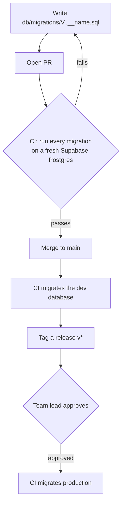

# Database Migrations

All changes to the database schema (tables, columns, functions, triggers, RLS policies, grants) are made as SQL files in `db/migrations/` and applied by [Flyway](https://documentation.red-gate.com/flyway). Don't change the schema in the Supabase dashboard.

## How a migration ships



Flyway keeps a record of applied migrations in `flyway.flyway_schema_history` and only runs files that a database hasn't seen yet.

## Writing a migration

1. Create `db/migrations/V<YYYYMMDD>_<HHMM>__<what_it_does>.sql`, using the current date and time (24h). For example: `V20261018_1430__add_rsvp_status.sql`.
2. Write plain SQL. Unqualified names mean `public`, the same as in the Supabase SQL editor.
3. Open a PR. CI builds a database from scratch with every migration, including yours.

Rules:

- **Never edit, rename or delete a migration once it is merged.** Databases have already run it, and Flyway rejects files whose checksum changed. To fix a mistake, add a new migration. CI blocks PRs that change merged migrations.
- **Only the API touches tables.** Since `V20261026_0320`, the browser roles (`anon`, `authenticated`) have no access to anything in `public`, and new tables start closed too. For a new table, `enable row level security`, then grant it to `api_app` and add an `api_app access` policy, like `V20261026_0310__api_role.sql` does.
- **Never grant to `anon` or `authenticated`.** Anything they can read, anyone with the website's public key can read.
- **No secrets.** Keys, webhook URLs and passwords don't belong in migrations.

### Testing locally (optional, needs Docker)

You don't need Docker to work on this repo: CI tests every PR. If you do have Docker, you can run the same check from the repo root:

```sh
docker run -d --name devs-db -e POSTGRES_PASSWORD=postgres -p 54322:5432 supabase/postgres:17.6.1.062
docker run --rm --network host -v "$PWD/db:/flyway/project" -w /flyway/project \
  -e FLYWAY_URL=jdbc:postgresql://localhost:54322/postgres -e FLYWAY_USER=postgres -e FLYWAY_PASSWORD=postgres \
  flyway/flyway:13.8.1 -configFiles=flyway.toml migrate
docker rm -f devs-db
```

## Files

| Path                                         | What it is                                                                                         |
| -------------------------------------------- | -------------------------------------------------------------------------------------------------- |
| `db/migrations/`                             | Migrations, applied in version order.                                                              |
| `db/migrations/V20261016_0000__baseline.sql` | The production schema when Flyway was introduced. Production is marked as already at this version. |
| `db/callbacks/beforeEachMigrate.sql`         | Resets `search_path` to `public` before each migration.                                            |
| `db/seed/dev_seed.sql`                       | Fake people and events for local Docker and the API's tests. Never run it against a real project.  |
| `db/flyway.toml`                             | Shared Flyway settings. Connection details come from environment variables.                        |
| `.github/workflows/database.yml`             | The CI pipeline above.                                                                             |

## Not managed by migrations (yet)

These live only in the Supabase dashboard of each project:

- Storage bucket settings beyond creation. `V20261119_1035` creates `event-images`, `event-payments` and `Links` if missing (it skips databases without Supabase Storage, like CI's); their browser-facing policies are removed by `V20261026_0320`, and the API uses the service role key.
- Cron jobs (`pg_cron`)
- Auth settings and edge function secrets
- The `marketing_webhook` database webhook on `public.marketing_requests`. It was left out of the baseline because it has a Supabase key and the prod URL inlined.

## One-time setup

1. **GitHub environments.** In the repo settings, create the environments `dev` and `production`. Give each the secrets below. Add the team lead as a required reviewer on `production`.

   | Secret            | Value                                                           |
   | ----------------- | --------------------------------------------------------------- |
   | `FLYWAY_URL`      | `jdbc:postgresql://<pooler host>:5432/postgres?sslmode=require` |
   | `FLYWAY_USER`     | `postgres.<project ref>`                                        |
   | `FLYWAY_PASSWORD` | The project's database password                                 |

   Use the **session pooler** connection details (Supabase dashboard > Connect). The direct connection is IPv6-only and GitHub's runners can't reach it. The transaction pooler (port 6543) doesn't work with Flyway.

2. **Baseline production.** Production already has the baseline schema, so Flyway must be told not to run it there. First check that nobody has changed the schema in the dashboard since 2026-10-16 (compare a fresh `supabase db dump` with the baseline file). Then, once, from the repo root:

   ```sh
   docker run --rm -v "$PWD/db:/flyway/project" -w /flyway/project \
     -e FLYWAY_URL='jdbc:postgresql://<pooler host>:5432/postgres?sslmode=require' \
     -e FLYWAY_USER='postgres.<project ref>' -e FLYWAY_PASSWORD \
     flyway/flyway:13.8.1 -configFiles=flyway.toml baseline
   ```

   The production job refuses to run until this is done.

3. **Dev database.** A new, empty dev project needs no baseline. The first merge to main builds the whole schema on it.

4. **API role password.** After `V20261026_0310` has run on a project, give `api_app` a password once in the SQL editor (`alter role api_app with password '...'`) and give it to the API's deployment. See [apps/api/README.md](../apps/api/README.md).
