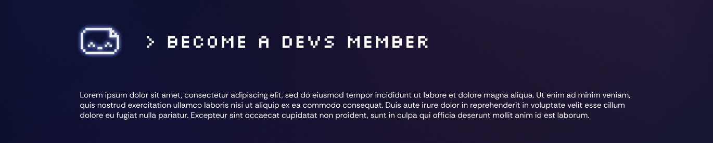

# PageTitle Component

The **PageTitle** component provides a consistent, branded header section for pages across the website.  
It displays an icon, a formatted title, and optional supporting text using a fixed layout.

## Purpose

Use this component to:
- Maintain consistent page title styling
- Enforce title formatting rules
- Reduce layout duplication across pages


## Layout

The component follows the layout below:


The title is automatically prefixed with `>` and converted to uppercase.

## Usage
### Basic Example

```tsx
import { PageTitle } from "@/components/PageTitle"

<PageTitle
  image="/icons/logo.png"
  title="Upcoming Events"
  subtext="See and register for our upcoming events"
/>
```

### Without subtext
```tsx
<PageTitle
  image="/icons/logo.png"
  title="Dashboard"
/>
```

## Props

| Prop        | Type     | Required | Description                                                                  |
| ----------- | -------- | -------- | ---------------------------------------------------------------------------- |
| `image`     | `string` | Yes      | Image URL or path displayed next to the title                                |
| `title`     | `string` | Yes      | Page title text (automatically prefixed with `>` and converted to uppercase) |
| `subtext`   | `string` | No       | Optional supporting text displayed below the title                           |
| `imageAlt`  | `string` | No       | Alt text for the image (defaults to `"Page Icon"`)                           |
| `className` | `string` | No       | Additional Tailwind classes for layout customization                         |

## Styling & Customization

You can extend or override layout styles using the className prop:

```tsx
<PageTitle
  image="/icons/logo.png"
  title="Docs"
  className="min-h-[80vh]"
/>
```

The component uses:
- Tailwind CSS for layout and spacing
- Pixelated image rendering
- Silkscreen font for the title

## Behavior Notes

- The title is automatically formatted:
    - Prefixed with >
    - Converted to uppercase
- The subtext is conditionally rendered and omitted if not provided
- The component is vertically centered and constrained to a max width
- Intended for full-page title sections, not inline headings

## When to Use

Use this component when:
- Creating a new page with a primary title section
- Consistent branding and spacing are required

Avoid using this component when:
- A small or inline heading is needed
- The page does not require a hero-style title section